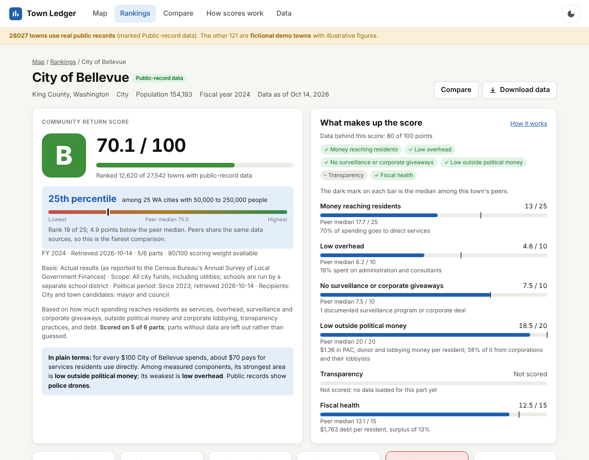

# TownView

**Live at [townview.org](https://townview.org).**

Plain-language bookkeeping for U.S. towns and townships. TownView shows where a town's money comes from (including everything besides property tax), where it goes, and what political money flows around local officials. It then grades how well that money comes back to residents.



## Features

- **Interactive map.** Every town appears as a dot (or an averaged grid in Heat mode), colored by how effectively it spends on residents. You can color it by the overall score, service dollars per resident, share of spending on services, political money per resident, or reliance on revenue other than property tax.
- **Town report card.** Each town gets a letter grade and a Community Return Score out of 100, with a plain-English breakdown of each part of the score.
- **Money in.** Every revenue stream: property tax, sales tax, state aid, federal grants, fees, utility charges, fines and borrowing. Property tax is shown separately.
- **Money out.** Direct services (police, fire, roads, water, parks, health) shown against overhead (administration, consultants, debt).
- **Red flags.** Surveillance tech (Flock license-plate cameras, facial recognition, ShotSpotter), data center contracts, private-developer subsidies and corporate tax breaks are flagged in red and cost points. Known surveillance vendors and data center deals are caught by name even when filed under police or general spending.
- **Corporate lobbying.** Shown inside Money in and Money out, not just beside them: how much corporations spent lobbying and donating, what they got back in tax breaks, and which companies both lobbied or donated and were paid by the town.
- **Political money.** Corporate lobbying, PAC, developer, contractor and union contributions to local officials, plus lobbying the town pays for, with a top-contributors table.
- **Transparency check.** Six good-government practices: budget online, open checkbook, on-time audit, competitive bidding, recorded meetings, and conflict-of-interest disclosures.
- **Ledger.** Individual transactions you can search, filter, sort and export to CSV.
- **Five-year trend** of revenue against spending.
- **Rankings.** A sortable table of every town, filterable by state, kind of government, population and grade, exportable to CSV, with filters kept in the link. **Rank among peers** compares each town only with towns in the same state, of the same kind and size; scores built on little data are marked provisional and listed last.
- **Peer comparison.** Each report card shows the town's percentile among its peers and the peer median on every part of the score.
- **States.** One card per state: governments loaded, median score, grade spread, red flags, late annual reports, and which parts of the score have data. Each card links to the map and rankings for that state (`#/map?state=MA`).
- **Compare.** Up to three towns side by side.
- **Town forums.** Each town has a discussion page (Forum button on its report), backed by GitHub Discussions through [giscus](https://giscus.app).
- **Bring your own data.** Import a JSON file in the browser, or build one with the scripts below.
- Light and dark themes, works on phones, no build step, no tracking.

## Run it

```bash
npm start          # http://localhost:8080  (Node 18+, no dependencies to install)
npm test           # engine, ledger, importer tests
```

## Deploy

It's a static site with no build step. `netlify.toml` and `vercel.json` set the cache and security headers, and the hosts compress the JSON data. The repository is about 350 MB, mostly `data/real/`, so Netlify is the safer choice; Vercel's Hobby plan may reject a deployment that large.

- **Netlify (recommended):** Add new site > Import from Git > pick this repo and the `main` branch. Leave the build command empty and set the publish directory to `.` (both are read from `netlify.toml`).
- **Vercel:** Add New > Project > import this repo. Set Framework Preset to "Other" and leave the build command empty. The output directory is `.` (from `vercel.json`).
- **Custom domain:** once the site is live, add the domain under the site's Domain settings (Netlify) or Project > Settings > Domains (Vercel), then point your DNS records where the host tells you to. Both hosts issue HTTPS certificates automatically.

Routing uses `#/` hashes, so no rewrite rules are needed. Any other static host works too.

### GitHub Pages (townview.org)

The live site is published by `.github/workflows/pages.yml`: every push to `main` runs `npm test`, assembles the site and deploys it to GitHub Pages (Settings > Pages > Source: **GitHub Actions**). Actions deployments ignore the `CNAME` file, so the custom domain is set once in the repository settings:

1. **Settings > Pages > Custom domain:** enter `townview.org` and save. When the certificate is ready (up to an hour), tick **Enforce HTTPS**.
2. **DNS at the registrar (IONOS):** replace the `@` A record with four A records pointing to GitHub Pages: `185.199.108.153`, `185.199.109.153`, `185.199.110.153`, `185.199.111.153`. Optionally add AAAA records `2606:50c0:8000::153`, `2606:50c0:8001::153`, `2606:50c0:8002::153`, `2606:50c0:8003::153`. Add a `CNAME` record for `www` pointing to `omant87.github.io`.
3. Optional: verify `townview.org` under your GitHub profile's Settings > Pages to protect it from takeover.

`robots.txt`, `sitemap.xml`, `site.webmanifest` and the social preview image (`img/og-image.png`) assume the townview.org domain.

### Forum setup

Forum posts live in this repo's GitHub Discussions, in the **Announcements** category (only maintainers and giscus can start threads there; anyone signed in to GitHub can reply). giscus creates a town's thread, titled with the town id, on its first comment. The repo and category ids are in `GISCUS` in `js/views/forum.js`; get new ones from [giscus.app](https://giscus.app) if the repo or category changes. Comments are moderated on GitHub.

## Data

The site shows only public-record towns (`data/real/`). The fictional demo dataset (`data/towns.json`, made by `npm run generate:demo`) stays in the repo for tests and local experiments, but the app no longer loads it and the Pages deploy leaves it out.

To use real figures, build a dataset with the pipeline scripts, then load it on the **Data** page:

| Source | Script | What it fills |
|---|---|---|
| [Census Annual Survey of Local Government Finances](https://www.census.gov/programs-surveys/gov-finances.html) | `scripts/import-census-finance.mjs` | Revenue and spending by category |
| [USAspending.gov](https://www.usaspending.gov) | `scripts/fetch-usaspending.mjs` | Federal grants and their ledger entries |
| State or county campaign-finance portal / lobbying registry (CSV export) | `scripts/import-contributions.mjs` | PAC, business and union contributions, corporate lobbying (`contributor_type` "Corporate lobbying"), town-paid lobbying ("Town-paid lobbying"), top donors |
| New Jersey municipal budget / User Friendly Budget (line items as CSV) | `scripts/import-nj-budget.mjs` | Revenue and spending by line, with one ledger row per budget line |
| Town budget, audit (ACFR) and website | edit the JSON | Transparency checks, debt, history, surveillance and data center contracts, corporate tax breaks |

Example:

```bash
node scripts/import-census-finance.mjs --file 2022FinEstDAT.txt --gov-id <14-digit id> \
  --id my-township-pa --name "My Township" --state PA --population 12000 --lat 40.8 --lng -77.7 --year 2022
node scripts/fetch-usaspending.mjs --state PA --city "My Town" --recipient "MY TOWNSHIP" --id my-township-pa --fy 2026
node scripts/import-contributions.mjs --csv contributions.csv --id my-township-pa
# -> data/my-township-pa.json, ready to load on the Data page
```

### New Jersey (all 564 municipalities)

`data/real/nj-<county>.json` holds every NJ town, built from the state's [User Friendly Budget Database](https://datahub.dca.nj.gov/datasets/user-friendly-budget-database) (adopted budgets, net debt, population, history back to 2015, and the school, county and fire-district taxes each town collects and pays over, which count in money in and out but not in the score) and [NJ ELEC](https://www.njelecefilesearch.com/SearchContributionToEntity) contributions to municipal candidates. Red flags come from the [EFF Atlas of Surveillance](https://atlasofsurveillance.org/) (police license-plate readers, drones, gunshot detection, face recognition), license-plate cameras mapped in OpenStreetMap ([DeFlock](https://deflock.org/)), and a hand-checked list of data center deals and corporate lobbying (`scripts/nj/corporate-deals.json`). Coverage and gaps: [docs/NJ_DATA_STATUS.md](docs/NJ_DATA_STATUS.md).

```bash
node scripts/nj/build-county.mjs --download                      # budget workbook + Census gazetteer
pip install openpyxl && python3 scripts/nj/ufb-to-json.py data/raw/nj/ufb-database.xlsm data/raw/nj/ufb.json
node scripts/nj/fetch-elec.mjs --all                              # campaign contributions (cached)
node scripts/nj/build-county.mjs --all
node scripts/nj/apply-pass-through.mjs                           # (only to refresh existing files without a full rebuild)
node scripts/nj/red-flags.mjs --download && node scripts/nj/red-flags.mjs   # surveillance, data center deals
node scripts/nj/status.mjs
```

### New York (about 1,525 towns, villages and cities)

`data/real/ny-<county>.json` holds every NY town, village and city that files with the State Comptroller, built from the Comptroller's [Annual Financial Report data](https://wwe1.osc.state.ny.us/localgov/findata/financial-data-for-local-governments.cfm) (actual revenue, spending and debt; history back to 2016), Census 2025 population estimates, and State Board of Elections contribution records on [data.ny.gov](https://data.ny.gov). New York City is not included. Coverage and gaps: [docs/NY_DATA_STATUS.md](docs/NY_DATA_STATUS.md).

```bash
node scripts/ny/download.mjs                       # Comptroller files, Census estimates, gazetteers
python3 scripts/ny/osc-to-json.py                  # condense ~5M rows into data/raw/ny/osc.json
node scripts/ny/fetch-politics.mjs --all           # campaign contributions (cached)
node scripts/ny/build-county.mjs --all && node scripts/ny/status.mjs
node scripts/build-summary.mjs                     # light index the app loads at startup
```

### Pennsylvania (about 2,550 townships, boroughs and cities)

`data/real/pa-<county>.json` holds every PA municipality that files an Annual Audit and Financial Report with the Department of Community and Economic Development, built from DCED's [Statewide Municipal Annual Financial Reports](https://apps.dced.pa.gov/munstats-public/ReportInformation2.aspx?report=StatewideMuniAfr) (actual revenue, spending and debt; history back to 2016) and Census 2025 population estimates. Political money is not scored for Pennsylvania: municipal candidates file with their county board of elections and no statewide database of those filings exists. Coverage and gaps: [docs/PA_DATA_STATUS.md](docs/PA_DATA_STATUS.md).

```bash
node scripts/pa/download.mjs
pip install xlrd && python3 scripts/pa/afr-to-json.py
node scripts/pa/build-county.mjs --all && node scripts/pa/status.mjs
node scripts/build-summary.mjs
```

### Connecticut (all 169 towns and the City of Groton)

`data/real/ct-<planning-region>.json` holds every CT town, grouped by the nine planning regions the Census uses in place of counties. Figures come from the Office of Policy and Management's Municipal Fiscal Indicators on data.ct.gov: [financial statements](https://data.ct.gov/d/d6pe-dw46) (actual general-fund revenue, spending and debt, plus town-owned utilities from the Census Bureau's finance survey), the [Uniform Chart of Accounts](https://data.ct.gov/d/e2qt-k238) (spending by department) and [town data](https://data.ct.gov/d/ej6f-y2wf) (history back to 2014). Connecticut towns pay for their schools, so school spending is on each report but left out of the services and overhead shares. Political money comes from each town's party town committees as filed with the [State Elections Enforcement Commission](https://seec.ct.gov/Portal/eCRIS/CurPreYears); candidates for town office file with their town clerk and are not included. Coverage and gaps: [docs/CT_DATA_STATUS.md](docs/CT_DATA_STATUS.md).

```bash
node scripts/ct/download.mjs
node scripts/ct/fetch-seec.mjs                     # town party committee receipts
node scripts/ct/build-county.mjs --all && node scripts/ct/status.mjs
node scripts/ct/apply-utilities.mjs          # adds town-owned utilities to existing files without a full rebuild
node scripts/build-summary.mjs
```

### Massachusetts (all 351 cities and towns)

`data/real/ma-<county>.json` holds every MA city and town, built from the Division of Local Services' [Schedule A reports](https://www.mass.gov/lists/schedule-a-reports-revenues-expenditures-and-more) (actual revenue and spending for the general fund, special revenue, capital projects and enterprise funds, history back to 2014), DLS [local receipts](https://dls-gw.dor.state.ma.us/reports/rdPage.aspx?rdReport=TaxRateRecap.PAGE3.LocalReceiptsAct_vs_Est) (to separate excise taxes from property tax) and [long-term debt](https://dls-gw.dor.state.ma.us/reports/rdPage.aspx?rdReport=Dashboard.Cat_6_Reports.LongTermDebt351), and Census 2025 population estimates. Like Connecticut, Massachusetts towns pay for their schools, so school spending is on each report but left out of the services and overhead shares. Political money comes from the [Office of Campaign and Political Finance](https://www.ocpf.us/): union and PAC contributions to party ward, town and city committees and to candidates for mayor and city council. Coverage and gaps: [docs/MA_DATA_STATUS.md](docs/MA_DATA_STATUS.md).

```bash
node scripts/ma/download.mjs                       # DLS Schedule A, receipts, debt; Census files
pip install openpyxl && python3 scripts/ma/dls-to-json.py
node scripts/ma/fetch-ocpf.mjs                     # campaign contributions (cached)
node scripts/ma/build-county.mjs --all && node scripts/ma/status.mjs
node scripts/ma/apply-other-funds.mjs          # adds special revenue, capital and enterprise funds to existing files without a full rebuild
node scripts/build-summary.mjs
```

### Rhode Island (all 39 cities and towns)

`data/real/ri-<county>.json` holds every RI city and town, built from the Division of Municipal Finance's [Municipal Transparency Portal](https://municipalfinance.ri.gov/municipal-transparency) (audited actual revenue and spending under the state's uniform chart of accounts, history back to FY 2016) and Census 2025 population estimates. Each town's school department reports separately on the same portal; its state and federal aid and its spending are added, counting the town's appropriation once. Debt outstanding is not available, so fiscal health is not scored. Political money comes from the Board of Elections' [ERTS](https://ricampaignfinance.com/RIPublic/Contributions.aspx): PAC contributions to local candidates and party city and town committees. The portal is behind a browser check, so `download.mjs` uses Playwright when installed (`npm i playwright`); otherwise save "MTP All Data" by hand as `data/raw/ri/mtp.csv`. Coverage and gaps: [docs/RI_DATA_STATUS.md](docs/RI_DATA_STATUS.md).

```bash
node scripts/ri/download.mjs                       # transparency portal data; Census files
node scripts/ri/fetch-erts.mjs                     # campaign contributions and filers (cached)
node scripts/ri/build-county.mjs --all && node scripts/ri/status.mjs
node scripts/ri/apply-schools.mjs          # adds town school departments to existing files without a full rebuild
node scripts/build-summary.mjs
```

### Maryland (all reporting municipalities and Baltimore City)

`data/real/md-<county>.json` holds every Maryland municipality that reported to the Department of Legislative Services, and Baltimore City, from DLS's [Local Government Finances in Maryland](https://dls.maryland.gov/budget/local-finances/) (actual revenue by source, spending by function and public debt, reconciled to audits; FY 2021 on) and Census 2025 population estimates. The reports are PDFs; `lgf-to-json.py` reads their tables with pdfplumber. Counties run schools and most services, and municipal candidates file campaign reports locally, so political money is not scored. Coverage and gaps: [docs/MD_DATA_STATUS.md](docs/MD_DATA_STATUS.md).

```bash
node scripts/md/download.mjs                       # DLS reports (PDF); Census files
pip install pdfplumber && python3 scripts/md/lgf-to-json.py
node scripts/md/build-county.mjs --all && node scripts/md/status.mjs
node scripts/build-summary.mjs
```

### Virginia (counties, independent cities and reporting towns)

`data/real/va-<county-or-city>.json` holds Virginia's counties (each with its towns) and independent cities, from the Auditor of Public Accounts' [Comparative Report of Local Government Revenues and Expenditures](https://www.apa.virginia.gov/local-government/reports?type=comparative-reports) (actual revenue, spending by function, capital, debt service, enterprise funds and debt from audited statements; FY 2023 on) and Census 2025 population estimates. Virginia has no townships, so counties are listed with cities and towns. Political money comes from the Department of Elections' [bulk campaign finance files](https://apps.elections.virginia.gov/SBE_CSV/CF/): business, union and PAC contributions to local candidates. Coverage and gaps: [docs/VA_DATA_STATUS.md](docs/VA_DATA_STATUS.md).

```bash
node scripts/va/download.mjs                       # APA comparative reports (Excel); Census files
pip install openpyxl && python3 scripts/va/apa-to-json.py
node scripts/va/fetch-elect.mjs                    # campaign finance (cached)
curl -o data/raw/va/zcta-county.txt https://www2.census.gov/geo/docs/maps-data/data/rel2020/zcta520/tab20_zcta520_county20_natl.txt
node scripts/va/build-county.mjs --all && node scripts/va/status.mjs
node scripts/build-summary.mjs
```

### North Carolina (counties, cities, towns and villages)

`data/real/nc-<county>.json` holds each North Carolina county and the municipalities whose people mostly live in it, from the Annual Financial Information Report each government files with the Local Government Commission on the Census Bureau's template, as published in the Census Bureau's [individual unit files](https://www.census.gov/programs-surveys/gov-finances.html) (actual revenue, spending by function, capital, debt service, utilities and debt; FY 2022 for every government, a sample in FY 2023 and 2024), and Census 2025 population estimates. Units whose figures the Census mostly estimated are left out. Political money comes from the State Board of Elections' [transaction search](https://cf.ncsbe.gov/CFTxnLkup/): PAC, union and other organizational contributions to county and municipal candidates. Coverage and gaps: [docs/NC_DATA_STATUS.md](docs/NC_DATA_STATUS.md).

```bash
node scripts/nc/download.mjs                       # Census unit files, population, gazetteers, ZIP areas
node scripts/nc/fetch-ncsbe.mjs                    # campaign finance (cached)
node scripts/nc/build-county.mjs --all && node scripts/nc/status.mjs
node scripts/build-summary.mjs
```

### South Carolina (counties, cities and towns)

`data/real/sc-<county>.json` holds each South Carolina county and the municipalities whose people mostly live in it, from what each government reported to the Census Bureau's [Annual Survey of State and Local Government Finances](https://www.census.gov/programs-surveys/gov-finances.html) (individual unit files: actual revenue, spending by function, capital, debt service, utilities and debt; FY 2022 for every government, a sample in FY 2023 and 2024) and Census 2025 population estimates. Units whose figures the Census mostly estimated, or that are incomplete, are left out, so about half of the municipalities are listed. School districts are separate governments. Political money comes from the State Ethics Commission's [public contribution search](https://ethicsfiling.sc.gov/public/campaign-reports/contributions): business, union and PAC contributions to county and municipal candidates, placed by the office sought. Coverage and gaps: [docs/SC_DATA_STATUS.md](docs/SC_DATA_STATUS.md).

```bash
node scripts/sc/download.mjs                       # Census unit files, population, gazetteers
node scripts/sc/fetch-ethics.mjs                   # campaign finance (cached)
node scripts/sc/build-county.mjs --all && node scripts/sc/status.mjs
node scripts/build-summary.mjs
```

### Georgia (counties, consolidated governments, cities and towns)

`data/real/ga-<county>.json` holds each Georgia county (or consolidated city-county government) and the cities whose people mostly live in it, from the Report of Local Government Finance each government files with the Department of Community Affairs ([viewer](https://apps.dca.ga.gov/RLGF/Default.aspx); actual revenue by UCOA account, spending by function including capital, enterprise funds, payments to other governments and debt, from audited figures where available; FY 2022 on) and Census 2025 population estimates. School districts are separate governments. Local candidates file campaign reports with their county or city, so political money is not scored. Coverage and gaps: [docs/GA_DATA_STATUS.md](docs/GA_DATA_STATUS.md).

```bash
node scripts/ga/download.mjs                       # DCA reports (Excel); Census files
pip install xlrd openpyxl && python3 scripts/ga/rlgf-to-json.py
node scripts/ga/build-county.mjs --all && node scripts/ga/status.mjs
node scripts/build-summary.mjs
```

### Florida (counties, cities, towns and villages)

`data/real/fl-<county>.json` holds each Florida county and the municipalities whose people mostly live in it (Jacksonville, consolidated with Duval County, heads Duval's file), from the Annual Financial Report each government files with the Department of Financial Services, as compiled by the Office of Economic and Demographic Research ([counties](https://www.edr.state.fl.us/Content/local-government/data/revenues-expenditures/cntyfiscal.cfm), [municipalities](https://www.edr.state.fl.us/Content/local-government/data/revenues-expenditures/munifiscal.cfm): actual revenue and spending by account code and fund type; FY 2022 on) and Census 2025 population estimates. School districts are separate governments. Debt outstanding is not in the EDR data, so fiscal health is not scored, and local candidates file campaign reports with their county or city, so political money is not scored. Coverage and gaps: [docs/FL_DATA_STATUS.md](docs/FL_DATA_STATUS.md).

```bash
node scripts/fl/download.mjs                       # EDR workbooks (Excel); Census files
pip install openpyxl && python3 scripts/fl/edr-to-json.py
node scripts/fl/build-county.mjs --all && node scripts/fl/status.mjs
node scripts/build-summary.mjs
```

### Delaware (counties, cities and towns)

`data/real/de-<county>.json` holds each Delaware county and the municipalities whose people mostly live in it, from what each government reported to the Census Bureau's [Annual Survey of State and Local Government Finances](https://www.census.gov/programs-surveys/gov-finances.html) (individual unit files, the same mapping as North and South Carolina; FY 2022 for every government, a sample in FY 2023 and 2024) and Census 2025 population estimates. Delaware has no statewide compilation of local finances, and the Census estimated rather than received Kent County's, Wilmington's and Dover's figures, so those are not listed. Political money comes from the Department of Elections' [Campaign Finance Reporting System](https://cfrs.elections.delaware.gov/Public/ViewReceiptsMain): business, union and PAC contributions to county candidates and to municipal candidates who raise more than $5,000, placed by committee. Coverage and gaps: [docs/DE_DATA_STATUS.md](docs/DE_DATA_STATUS.md).

```bash
node scripts/de/download.mjs                       # Census unit files, population, gazetteers
NODE_PATH=$(npm root -g) node scripts/de/fetch-cfrs.mjs   # campaign finance (Playwright; cached)
node scripts/de/build-county.mjs --all && node scripts/de/status.mjs
node scripts/build-summary.mjs
```

### New Hampshire (counties, cities and towns)

`data/real/nh-<county>.json` holds each New Hampshire county and its cities and towns, from what each government reported to the Census Bureau's [Annual Survey of State and Local Government Finances](https://www.census.gov/programs-surveys/gov-finances.html) (individual unit files, the same mapping as the Carolinas and Delaware; the Census counts New Hampshire towns as township governments) and Census 2025 population estimates. Towns collect the school district's, county's and state education tax shares on the same bill; where a town reported the whole levy as its own, only the town's share is kept, and the few towns that filed their school and county assessments as their own spending have those left out (`scripts/common/levy.mjs`; New Hampshire, Vermont and Maine share `scripts/common/town-census-build.mjs`). The Census estimated rather than received about 100 governments' figures, including Concord's and Portsmouth's, so those are not listed. Political money is not scored: local candidates file with their town or city clerk. Coverage and gaps: [docs/NH_DATA_STATUS.md](docs/NH_DATA_STATUS.md).

```bash
node scripts/nh/download.mjs                       # Census unit files, population, gazetteers
node scripts/nh/build-county.mjs --all && node scripts/nh/status.mjs
node scripts/build-summary.mjs
```

### Vermont (counties, cities, towns and villages)

`data/real/vt-<county>.json` holds each Vermont county and its cities, towns and incorporated villages, built the same way as New Hampshire from the Census unit files and Census 2025 population estimates. Towns collect the state education tax and the county tax on the same bill; where a town reported the whole levy as its own, the education tax the Department of Taxes lists for that town ([PVR annual report data](https://tax.vermont.gov/pvr-annual-report)) is taken out, so the town's real surplus or deficit is kept; villages are a second layer inside a town and are listed separately. The Census estimated rather than received about 120 governments' figures, including Bennington and Washington Counties'. Political money is not scored: local candidates do not file with the state. Coverage and gaps: [docs/VT_DATA_STATUS.md](docs/VT_DATA_STATUS.md).

```bash
node scripts/vt/download.mjs                       # Census unit files, population, gazetteers, VT tax file
node scripts/vt/build-county.mjs --all && node scripts/vt/status.mjs
node scripts/build-summary.mjs
```

### Maine (counties, cities, towns and plantations)

`data/real/me-<county>.json` holds each Maine county and its cities, towns and plantations, built the same way as New Hampshire. Towns collect their school unit's assessment and the county tax on the same bill, handled as in New Hampshire. The Census estimated rather than received over 200 governments' figures, including York County's. Political money is not scored: local candidates file with their municipal clerk. Coverage and gaps: [docs/ME_DATA_STATUS.md](docs/ME_DATA_STATUS.md).

```bash
node scripts/me/download.mjs
node scripts/me/build-county.mjs --all && node scripts/me/status.mjs
node scripts/build-summary.mjs
```

### Ohio (counties, cities, villages and townships)

`data/real/oh-<county>.json` holds each Ohio county and the cities, villages and townships whose people mostly live in it, built with the same shared Census unit-file builder as northern New England (`scripts/common/town-census-build.mjs`) but without its property tax rules, since county treasurers collect every levy. The Census estimated rather than received about 1,000 Ohio governments' figures (mostly small townships and villages, plus Youngstown and 35 counties), so those are not listed. Townships with the same name in different counties carry the county in their id. Political money is not scored: local candidates file with their county board of elections. Coverage and gaps: [docs/OH_DATA_STATUS.md](docs/OH_DATA_STATUS.md).

```bash
node scripts/oh/download.mjs
node scripts/oh/build-county.mjs --all && node scripts/oh/status.mjs
node scripts/build-summary.mjs
```

### Michigan (counties, cities, villages and townships)

`data/real/mi-<county>.json` holds each Michigan county and the cities, villages, townships and charter townships whose people mostly live in it, built the same way as Ohio. Nearly every Michigan government reported to the Census in 2022. Political money is not scored: local candidates file with their county clerk. Coverage and gaps: [docs/MI_DATA_STATUS.md](docs/MI_DATA_STATUS.md).

```bash
node scripts/mi/download.mjs
node scripts/mi/build-county.mjs --all && node scripts/mi/status.mjs
node scripts/build-summary.mjs
```

### Indiana (counties, cities, towns and townships)

`data/real/in-<county>.json` holds each Indiana county and the cities, towns and townships whose people mostly live in it, plus the Consolidated City of Indianapolis, from each government's Annual Financial Report on [Indiana Gateway](https://gateway.ifionline.org/public/download.aspx) (cash receipts and disbursements on the state's uniform chart of accounts) rather than the Census unit files, which have estimated figures for many Indiana townships and towns. Money counties collect for other governments, payroll and clearing accounts, internal service funds, transfers, investments, borrowing and refinancing are left out (`scripts/in/gateway-map.mjs`). Indiana's accounts have no function codes, so spending is assigned to services by department or fund name; a general fund reported without departments is shown as not broken down when it is more than 15% of spending, and that government is not scored on services or overhead. Political money is not scored: local candidates file with their county election board. Coverage and gaps: [docs/IN_DATA_STATUS.md](docs/IN_DATA_STATUS.md).

```bash
node scripts/in/gateway-download.mjs              # Gateway AFR files, population, gazetteers
node scripts/in/gateway-build.mjs --all && node scripts/in/gateway-status.mjs
node scripts/build-summary.mjs
```

### Illinois (counties, cities, villages, towns and townships)

`data/real/il-<county>.json` holds each Illinois county and the cities, villages, towns and townships whose people mostly live in it, from each government's Annual Financial Report in the [Illinois Comptroller's local government financial databases](https://illinoiscomptroller.gov/constituent-services/local-government/local-government-division/financial-databases/) (revenues by source, expenditures by function, debt; one Access database per fiscal year, read with mdbtools) rather than the Census unit files. Fiduciary funds (pension trusts and the money county collectors hold for every district), internal service funds, component units and depreciation are left out; capital outlay without a function is spread over each government's services (`scripts/il/comptroller-map.mjs`). Political money comes from the [State Board of Elections](https://www.elections.il.gov/campaigndisclosure/downloadcddatafiles.aspx), where every Illinois committee files: business, union and PAC contributions to county, municipal and township candidates, placed by the office each candidate filed for (`scripts/il/politics.mjs`). Coverage and gaps: [docs/IL_DATA_STATUS.md](docs/IL_DATA_STATUS.md).

```bash
node scripts/il/comptroller-download.mjs          # Comptroller databases (needs mdbtools), population, gazetteers
node scripts/il/fetch-isbe.mjs                     # campaign finance (~1 GB download; cached)
node scripts/il/comptroller-build.mjs --all && node scripts/il/comptroller-status.mjs
node scripts/build-summary.mjs
```

### Wisconsin (counties, cities, villages and towns)

`data/real/wi-<county>.json` holds each Wisconsin county and the cities, villages and towns whose people mostly live in it, from each government's Municipal Financial Report as compiled by the Wisconsin Department of Revenue ([County and Municipal Revenues and Expenditures](https://www.revenue.wi.gov/Pages/Report/county-municipal-revenues-expenditures.aspx), calendar 2023-2024) rather than the Census unit files: spending by function for governmental funds, utility funds as totals, borrowing and transfers left out (`scripts/wi/dor-map.mjs`). Political money is not scored: local candidates file with their municipal clerk. Coverage and gaps: [docs/WI_DATA_STATUS.md](docs/WI_DATA_STATUS.md).

```bash
node scripts/wi/dor-download.mjs                  # DOR workbooks, population, gazetteers
node scripts/wi/dor-build.mjs --all && node scripts/wi/dor-status.mjs
node scripts/build-summary.mjs
```

### Minnesota (counties, cities and townships)

`data/real/mn-<county>.json` holds each Minnesota county and the cities and townships whose people mostly live in it, built the same way as Ohio and Michigan. Political money is not scored: local candidates file locally, not with the Campaign Finance Board. Coverage and gaps: [docs/MN_DATA_STATUS.md](docs/MN_DATA_STATUS.md).

```bash
node scripts/mn/download.mjs
node scripts/mn/build-county.mjs --all && node scripts/mn/status.mjs
node scripts/build-summary.mjs
```

### Iowa (counties and cities)

`data/real/ia-<county>.json` holds each Iowa county and the cities whose people mostly live in it, built the same way as Ohio and Michigan. Iowa's townships are not governments in the Census count, so none are listed. Almost every city reported to the Census; about 40 counties' figures were estimated and are left out. Political money is not scored yet. Coverage and gaps: [docs/IA_DATA_STATUS.md](docs/IA_DATA_STATUS.md).

```bash
node scripts/ia/download.mjs
node scripts/ia/build-county.mjs --all && node scripts/ia/status.mjs
node scripts/build-summary.mjs
```

### Missouri (counties, St. Louis, cities, towns, villages and townships)

`data/real/mo-<county>.json` holds each Missouri county and the governments whose people mostly live in it, and `mo-st-louis-city.json` the independent City of St. Louis, built the same way as Ohio and Michigan. The Census estimated or has incomplete records for about 730 Missouri governments, including 57 counties, so coverage is about half. Political money is not scored yet. Coverage and gaps: [docs/MO_DATA_STATUS.md](docs/MO_DATA_STATUS.md).

```bash
node scripts/mo/download.mjs
node scripts/mo/build-county.mjs --all && node scripts/mo/status.mjs
node scripts/build-summary.mjs
```

### Kansas (counties, cities and townships)

`data/real/ks-<county>.json` holds each Kansas county and the cities and townships whose people mostly live in it, built the same way as Ohio and Michigan. Kansas City is unified with Wyandotte County and reports as one city. The Census estimated, or has incomplete records for, about 1,200 Kansas governments, so coverage is about a third. Political money is not scored yet. Coverage and gaps: [docs/KS_DATA_STATUS.md](docs/KS_DATA_STATUS.md).

```bash
node scripts/ks/download.mjs
node scripts/ks/build-county.mjs --all && node scripts/ks/status.mjs
node scripts/build-summary.mjs
```

### Nebraska (counties, cities and villages)

`data/real/ne-<county>.json` holds each Nebraska county and the cities and villages whose people mostly live in it, built the same way as Ohio and Michigan. Township governments are left out: their Census records show road spending about twice their reported revenue, so their revenue appears incomplete. Political money comes from the [Accountability and Disclosure Commission](https://nadc-e.nebraska.gov/PublicSite/DataDownload.aspx): business, union and PAC contributions to county, mayor and city council candidates who file with it (above $5,000 raised or spent). Coverage and gaps: [docs/NE_DATA_STATUS.md](docs/NE_DATA_STATUS.md).

```bash
node scripts/ne/download.mjs
node scripts/ne/fetch-nadc.mjs                     # political money (optional)
node scripts/ne/build-county.mjs --all && node scripts/ne/status.mjs
node scripts/build-summary.mjs
```

### North Dakota and South Dakota (counties, cities, towns and townships)

`data/real/nd-<county>.json` and `data/real/sd-<county>.json` hold each county and the cities, towns and townships whose people mostly live in it, built the same way as Ohio and Michigan. The Census estimated, or has incomplete records for, about 800 governments in each state (mostly townships and small towns), so coverage is about half in North Dakota and a third in South Dakota. Political money is not scored yet. Coverage and gaps: [docs/ND_DATA_STATUS.md](docs/ND_DATA_STATUS.md), [docs/SD_DATA_STATUS.md](docs/SD_DATA_STATUS.md).

```bash
node scripts/nd/download.mjs && node scripts/nd/build-county.mjs --all && node scripts/nd/status.mjs
node scripts/sd/download.mjs && node scripts/sd/build-county.mjs --all && node scripts/sd/status.mjs
node scripts/build-summary.mjs
```

### Texas and California (counties, cities, towns and villages)

`data/real/tx-<county>.json` and `data/real/ca-<county>.json` hold each county and the municipalities whose people mostly live in it, built the same way as Ohio and Michigan (neither state has townships). California is built instead from each government's Financial Transactions Report to the [State Controller](https://bythenumbers.sco.ca.gov/) (fiscal 2023-24 revenues, expenditures and debt for every county and city); San Francisco is a consolidated city and county and reports as one city. In Texas the Census estimated, or has incomplete records for, about 700 governments, mostly small cities and towns and about 110 counties. Political money is not scored yet. Coverage and gaps: [docs/TX_DATA_STATUS.md](docs/TX_DATA_STATUS.md), [docs/CA_DATA_STATUS.md](docs/CA_DATA_STATUS.md).

```bash
node scripts/tx/download.mjs && node scripts/tx/build-county.mjs --all && node scripts/tx/status.mjs
node scripts/ca/download.mjs && node scripts/ca/sco-download.mjs && python3 scripts/ca/sco-debt-to-json.py
node scripts/ca/sco-build.mjs --all && node scripts/ca/status.mjs
node scripts/build-summary.mjs
```

### Washington and Oregon (counties, cities and towns)

`data/real/wa-<county>.json` and `data/real/or-<county>.json` hold each county and the cities and towns whose people mostly live in it, built the same way as Texas and California. Washington coverage is nearly complete; in Oregon the Census estimated, or has incomplete records for, 86 governments, including 8 counties and Beaverton. Washington political money comes from the [Public Disclosure Commission](https://data.wa.gov/d/kv7h-kjye): business, union and PAC contributions to county, city and town candidates (`node scripts/wa/fetch-pdc.mjs` before building); it is not scored for Oregon yet. Coverage and gaps: [docs/WA_DATA_STATUS.md](docs/WA_DATA_STATUS.md), [docs/OR_DATA_STATUS.md](docs/OR_DATA_STATUS.md).

```bash
node scripts/wa/download.mjs && node scripts/wa/fetch-pdc.mjs && node scripts/wa/build-county.mjs --all && node scripts/wa/status.mjs   # fetch-pdc: Public Disclosure Commission contributions
node scripts/or/download.mjs && node scripts/or/build-county.mjs --all && node scripts/or/status.mjs
node scripts/build-summary.mjs
```

### Arizona and Colorado (counties, cities and towns)

`data/real/az-<county>.json` and `data/real/co-<county>.json` hold each county and the cities and towns whose people mostly live in it, built the same way as Texas and California. Denver and Broomfield are consolidated cities and counties and report as one city each. Colorado coverage is nearly complete; in Arizona the Census estimated, or has incomplete records for, 39 governments, including 4 counties and small cities such as Nogales, Bisbee and Globe. Colorado county political money comes from the Secretary of State's [TRACER](https://tracer.sos.colorado.gov/PublicSite/DataDownload.aspx) bulk files (`node scripts/co/fetch-tracer.mjs` before building); Colorado cities and Arizona are not scored yet. Coverage and gaps: [docs/AZ_DATA_STATUS.md](docs/AZ_DATA_STATUS.md), [docs/CO_DATA_STATUS.md](docs/CO_DATA_STATUS.md).

```bash
node scripts/az/download.mjs && node scripts/az/build-county.mjs --all && node scripts/az/status.mjs
node scripts/co/download.mjs && node scripts/co/build-county.mjs --all && node scripts/co/status.mjs
node scripts/build-summary.mjs
```

### The remaining states and DC (counties, cities, towns and villages)

`data/real/<state>-<county>.json` for Alabama, Alaska, Arkansas, Hawaii, Idaho, Kentucky, Louisiana, Mississippi, Montana, Nevada, New Mexico, Oklahoma, Tennessee, Utah, West Virginia, Wyoming and the District of Columbia holds each county (borough in Alaska, parish in Louisiana) and the municipalities whose people mostly live in it, built the same way as Texas and California. Consolidated city-counties the Census files as municipalities (Anchorage, Juneau, Sitka, Wrangell, Honolulu, Lexington-Fayette, Louisville Metro, Anaconda-Deer Lodge, Butte-Silver Bow, Carson City, Metro Nashville and Lynchburg-Moore) are placed at their county with the `consolidated` option. Tennessee, Alaska and DC run schools inside county, borough or city governments, so school spending is included there and kept out of the services and overhead shares. Coverage is lowest where many small towns did not report to the Census (Oklahoma, Alabama, Arkansas, Louisiana, Mississippi, Tennessee).

Political money is scored for nine of them. Alabama comes from the Secretary of State's Fair Campaign Practices Act bulk files (county candidates placed by the county their committee lists; mayor and council candidates by their mailing city), Alaska from the Public Offices Commission's income export (borough and city mayor, assembly and council candidates), Montana from the Commissioner of Political Practices' reporting system (county candidates placed by county of residence, city candidates by mailing city), Nevada from the Secretary of State's report search (behind a bot check, so `fetch-sos.mjs` drives a browser with Playwright, like Rhode Island's download; contributions joined to candidates by name), Hawaii from the Campaign Spending Commission's open data (county mayor, council and prosecuting attorney candidates), DC from the Office of Campaign Finance (mayor, council and attorney general), Kentucky from the Registry of Election Finance's public search (county and city candidates, matched by name to their office and location), Louisiana from the Board of Ethics' e-filed contributions, matched by filer name to the office each candidate typed (partial coverage), and Oklahoma from the Ethics Commission's bulk contribution files, each candidate committee placed by the jurisdiction on its registration page (few local candidates there raise money from organizations). In the other eight (Arkansas, Idaho, Mississippi, New Mexico, Tennessee, Utah, West Virginia and Wyoming), local candidates file with counties or cities, or the state's data is behind a login, a bot wall or unreachable, so political money is not scored yet. Coverage and gaps: `docs/<ST>_DATA_STATUS.md`.

```bash
node scripts/al/fetch-fcpa.mjs && node scripts/ak/fetch-apoc.mjs && node scripts/mt/fetch-copp.mjs && node scripts/nv/fetch-sos.mjs && node scripts/hi/fetch-csc.mjs && node scripts/dc/fetch-ocf.mjs && node scripts/ky/fetch-kref.mjs && node scripts/la/fetch-ethics.mjs && node scripts/ok/fetch-guardian.mjs   # political money (optional)
for st in al ak ar dc hi id ky la ms mt nv nm ok tn ut wv wy; do
  node scripts/$st/download.mjs && node scripts/$st/build-county.mjs --all && node scripts/$st/status.mjs
done
node scripts/build-summary.mjs
```

For every state built with `scripts/common/town-census-build.mjs` (New Hampshire through the remaining states above), principal repaid with new borrowing that was not spent on capital that year is treated as refinancing or a rolled-over note and left out of debt service. Wisconsin governments roll over short-term notes often, so it matters most there.

### Red flags in every state

Surveillance programs from the [EFF Atlas of Surveillance](https://atlasofsurveillance.org/) are matched to municipal police departments, and to sheriffs and county police where a state's counties are listed, so the red-flag part is scored in every state. Builds rewrite their county files, so re-run it after any build:

```bash
node scripts/cameras.mjs --all                    # every state but NJ: OpenStreetMap / DeFlock cameras
node scripts/red-flags.mjs --download && node scripts/red-flags.mjs   # every state except NJ (NJ: scripts/nj/red-flags.mjs); --state MA,TN for some
node scripts/transparency.mjs --all                 # NY, PA, CT, MA, FL, RI, VA: has each government filed its latest annual report?
node scripts/census-debt.mjs --state FL,RI          # debt outstanding from Census unit files where the state's data has none
node scripts/build-summary.mjs
```

License-plate cameras mapped in OpenStreetMap (from DeFlock's published tiles) are placed inside Census city, town and village boundaries in every state, and inside independent cities and city-counties (`scripts/cameras.mjs`; NJ uses `scripts/nj/red-flags.mjs`); ordinary counties overlap their towns, so they are not placed; any Flock camera is a red flag, other brands only when the town is the recorded operator. Atlas records for access every police department gets through a statewide contract (for example, Massachusetts's and Tennessee's CrimeTracer contracts) are shown but not scored. `scripts/transparency.mjs` checks one transparency practice from state records where the state publishes annual-report filings.

Every town is checked with `js/engine/validate.js` when the app scores it. The NJ, NY and PA builds and the shared Census build also run the checks, and `npm test` runs them over every state's data; the few towns whose own filings don't add up are listed with a reason in `tests/known-data-errors.json`. It catches revenue or spending missing from a filing, budgets whose two sides are far apart, partial years in the trend, and ledgers that don't add up. A town that fails is shown as **data under review** without a grade. The checks are described in [docs/METHODOLOGY.md](docs/METHODOLOGY.md#data-checks), and each state's status doc lists the towns they flag.

If the Overpass server doesn't answer, `scripts/nj/red-flags.mjs` reuses the camera counts saved in `scripts/nj/osm-cameras.json` from the last successful download.

The app loads `data/real/summary.json` (every real town without ledgers and history) at startup and fetches a county's full file only when a town report is opened. Re-run `node scripts/build-summary.mjs` after any county build, red-flags, cameras or transparency run.

Real towns go in `data/real/` and are listed in `data/real/index.json`. The app loads them by default, marks them **Public-record data**, and lets you filter to them on the map and rankings.

See [docs/DATA_SCHEMA.md](docs/DATA_SCHEMA.md) for every field and [docs/METHODOLOGY.md](docs/METHODOLOGY.md) for how scores are calculated.

## Project layout

```
index.html, css/, js/app.js     app shell, styles, router
js/views/                       map, town report, rankings, states, compare, method, data
js/engine/                      pure scoring + ledger logic (shared by app, scripts, tests)
js/charts.js                    small SVG chart helpers
data/towns.json                 fictional demo dataset (tests only, not deployed)
scripts/                        demo generator, real-data importers, dev server
tests/                          node --test suite
vendor/                         Leaflet 1.9.4 (BSD-2-Clause)
```

Map tiles come from Esri's World Light Gray and Dark Gray Canvas basemaps. State outlines (`data/us-states.json`) are built from the [us-atlas](https://github.com/topojson/us-atlas) package (ISC, U.S. Census Bureau boundaries) and show underneath the tiles, so the map stays usable when tiles are unavailable.

## Trust and usability

- Missing figures display as **Not available**, while reported zero stays zero.
  Towns below the grading coverage threshold display **Not graded**. Grades show
  fiscal year, retrieval date, component coverage and available scoring weight.
- **Public-record data** describes provenance, not independent verification.
  Reports and comparisons show financial basis/scope and political period/recipients.
- Compare starts empty, supports three searchable town selectors, and highlights
  winners only where the available measures have compatible reporting context.
- Rankings display 50 results per page; CSV export includes every filtered result
  with availability explanations. Map and rankings list only states in the active
  data filter; unknown measures are excluded from heat and color scales.
- Failed county requests can be retried. Navigation and dataset changes invalidate
  pending report rendering. Public-data loading failures are displayed explicitly.
- The Data page offers **Download summary**, **Download complete records**, and
  **Restore bundled data**. Complete exports hydrate county records and never
  silently omit a failed county. Imported JSON is validated before replacing data.

Run `npm test` for scoring, import, availability, loading, export, and all-county
summary/detail consistency checks. Scoring weights and thresholds are unchanged.
See [release validation](docs/RELEASE_VALIDATION.md) for browser checks and limits.

Next planned work: shareable filters and comparisons, printable reports with
sources, and a coverage explorer. Geographic expansion and methodology changes
remain separate projects.
